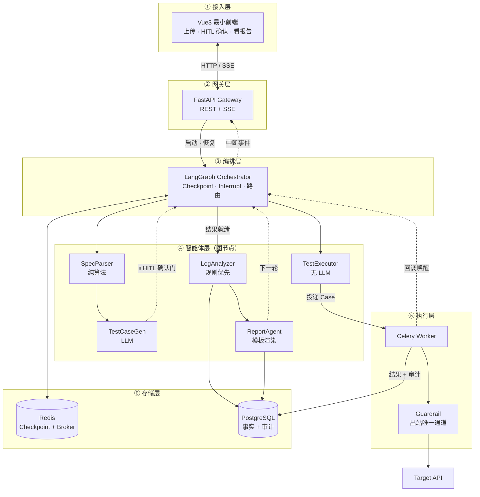
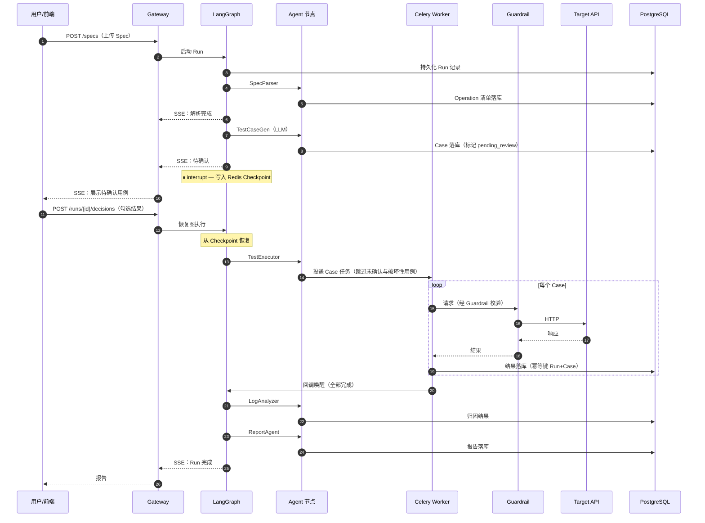

# TestFlow 架构设计（HLD）

| 项目 | 内容 |
| :--- | :--- |
| 文档版本 | v0.1 |
| 文档状态 | 评审中 |
| 最后更新 | 2026-10-13 |
| 上游文档 | [01-TestFlow_PRD.md](01-TestFlow_PRD.md)（需求唯一事实来源） |
| 关联蓝图 | [TestFlow 架构图](../imgs/TestFlow架构图.svg)（V2.0 终态） |

> **本文档的边界**：只回答"系统如何组成、为什么这样组成、数据如何在其中流动"。**不做**：接口字段定义（见 `05-API契约.md`）、表结构（见 `04-数据模型.md`）、图状态机细节（见 `06-Agent编排.md`）、各模块内部实现（见 `03-模块详细设计/`）。
>
> **本文档描述 MVP（P0）架构**。凡涉及 V1.0/V2.0 的组件，一律显式标注版本，不得混入 MVP 视图。

**编号约定**：`D` = 架构决策（Design decision，后续将各拆一篇 ADR）；`Q` = 开放问题（Open question）；`SR`/`M`/`F` 沿用 PRD 编号。

---

## 1. 架构总览

### 1.1 分层视图（MVP）



### 1.2 与终态蓝图的差异

PRD §3.1 已定义版本分期。此处只列**架构层面的差异及其影响**：

| 终态组件 | MVP 替代方案 | 架构影响 |
| :--- | :--- | :--- |
| 独立 Egress Proxy 进程 | 进程内 Guardrail 库（httpx 中间件） | 出站渠道由"网络隔离"降级为"代码约定"，见 D2 |
| 向量库 + BM25 混合检索 | 规则归因（无检索） | `LogAnalyzer` 无外部依赖，V1.0 引入时须新增存储层组件 |
| 对象存储（大日志） | 日志整体入 PG `TEXT` | 需设定单条日志上限，超限截断并标记（见 Q3） |
| Callback API | SSE 长连接单通道 | 无需公网可达的回调地址，MVP 可纯内网部署 |
| 双路径（短任务 await / 长任务提交） | 单队列，统一异步 | 见 D6 |
| 本地 Sandbox | 仅打外部测试环境 | 平台自身不执行用户代码，攻击面显著缩小 |

### 1.3 进程与队列拓扑

§1.1 是**逻辑分层**视图，不是物理部署视图。MVP 的物理拓扑为**三个进程、两条队列**：

| 进程 | 职责 | 消费队列 |
| :--- | :--- | :--- |
| Gateway（FastAPI） | REST · SSE · 内部唤醒端点 | — |
| Orchestrator | 推进 LangGraph 至下一个中断点 | `orchestrate` |
| Celery Worker | 经 Guardrail 打目标 API | `exec` |

**两条队列必须分开**：编排指令与出站请求的语义、并发度、失败处理策略完全不同，混用会互相饿死。

> **权威描述**：进程间交互、唤醒路径、完成判定与锁机制见 `06-Agent编排.md` §1.3 与 §6；具体配置项（队列名、并发数、TTL）见 `10-部署运维.md`。本节仅做逻辑视图与物理视图的桥接，不重复其内容。

---

## 2. 分层说明

### 2.1 接入层

MVP 有**两个客户端**，服务同一套 Gateway 接口：

| 客户端 | 形态 | 职责 |
| :--- | :--- | :--- |
| **Vue3 最小页** | 三个视图：上传 Spec、HITL 确认（勾选用例）、查看报告 | 含确认环节；**不含**监控大屏与实时执行瀑布图（V1.0） |
| **CLI** | `testflow run / status / report` | 从本地路径提交 Spec、查看进度与结果；**不含确认环节**（PRD F9） |

**CLI 是纯 HTTP 客户端**，不重复实现解析、生成、执行逻辑，也不内嵌本地模式直连内部模块（PRD §3.2 的 F9 约束）。它存在的理由是省去"打开浏览器、拖文件"的步骤，而不是提供第二条业务路径。

该层的架构职责仅有一项：**消费 SSE 流**并渲染（CLI 的 `--follow` 复用同一 SSE 接口）。所有状态由服务端持有，客户端不做本地状态推断——避免与 Checkpoint 状态产生第二事实来源。

### 2.2 网关层

FastAPI。承担的职责：

| 职责 | 说明 |
| :--- | :--- |
| REST 入口 | Spec 上传、触发 Run、提交 HITL 决策、拉取报告 |
| SSE 单通道 | 推送图进展事件（节点开始/结束、中断、错误） |
| 响应脱敏 | **对外响应体与 SSE 事件的统一出口**，剥离敏感字段。注意边界：**应用日志的脱敏不是 Gateway 的职责**——见下方修正说明 |
| 认证 | MVP 单用户，一个静态 Token；不引入用户体系（PRD §3.3） |

**不做**：业务逻辑。网关是薄层，任何规则判断都应下沉到编排层或模块层，否则会形成绕过 Guardrail 的第二条路径。

> **⚠️ 修正（v0.4）**：v0.1 曾把"日志脱敏"列为本层职责。但系统有三个进程（`06` §1.3），**Worker 与 Orchestrator 的日志根本不经过 Gateway**——若脱敏只在这里实现，这两个进程的日志就没有任何保护。
>
> 正确的划分：**脱敏是 `observability/logging.py` 的输出过滤器，三个进程共用**；本层的"统一出口"作用体现在**对外响应体与 SSE 事件**上。两者的对象不同，不应混为一谈。详见 `07-非功能需求.md` §5.5（NF7）。

### 2.3 编排层

LangGraph。这是整个系统的技术核心，MVP 必须完整实现（PRD §3.1）。

| 能力 | 用途 |
| :--- | :--- |
| 状态机 + 条件路由 | 定义 `SpecParser → TestCaseGen → [中断] → TestExecutor → LogAnalyzer → ReportAgent` 主链，以及失败重试、部分失败等分支 |
| Checkpoint（Redis） | 每节点执行后落盘，支撑 F8（可中断可恢复） |
| `interrupt` | HITL 中断门的实现机制，见 PRD §4.2 |

编排层本身**不含 LLM 调用**——LLM 只出现在 Agent 层节点内部。这条边界让"编排逻辑"与"AI 行为"可分别测试。

### 2.4 智能体层

五个图节点，但只有两个真正调用 LLM。这直接体现 PRD §1.1 的技术主张：

| 节点 | 是否用 LLM | 职责 | 关键约束 |
| :--- | :--- | :--- | :--- |
| `SpecParser` | ❌ | 解析 Spec → 结构化 Operation 清单 | 纯算法（`prance` + `openapi-spec-validator`），见 D3 |
| `TestCaseGen` | ✅ | Operation → 正常/异常/边界用例 | 结构化输出强约束，见 §5.2 |
| `TestExecutor` | ❌ | 组装 Case → 投递 Celery → 汇集结果 | 不直接发 HTTP，见 D1 |
| `LogAnalyzer` | ✅（兜底） | 失败 Case → 归因类别 | **规则优先**：规则命中则不调 LLM |
| `ReportAgent` | ❌ | 聚合结果 → 报告 | 模板渲染（Jinja2），见 D5 |

> **`TestExecutor` 的定位说明**：终态蓝图中它被画在 Agent 层，但它既无 LLM 也无自主决策，实质是编排层与执行层之间的**适配器**。保留其在图节点中的位置是为了让 Checkpoint 粒度与"一个可恢复的工作单元"对齐，不是因为它具备智能体特性。

### 2.5 执行层

Celery Worker Pool 负责对**目标 API** 的出站请求。职责分离：

```
TestExecutor（编排层内）     →  组装 Case、投递任务、不接触网络
Celery Worker（执行层）      →  消费任务、经由 Guardrail 打目标 API、回写结果
```

**系统存在两条出站路径，且都必须经 Guardrail**：执行层打目标 API（同步客户端）、编排层的 `TestCaseGen` / `LogAnalyzer` 调 LLM 提供商（异步客户端）。这是 D1「编排 async / 执行 sync」与 D2「唯一出站通道」两条决策的交汇处——Guardrail 因此需要提供两种客户端形态，详见 D2 与 D7。

### 2.6 存储层

| 存储 | 承载数据 | 为何选它 |
| :--- | :--- | :--- |
| **Redis** | LangGraph Checkpoint、Celery Broker | 两者都要求低延迟读写且可丢弃，一物两用 |
| **PostgreSQL** | Spec、Operation、Case、Run、执行结果、审计日志 | 需要事务与关系约束；MVP 数据量无需归档 |

**V1.0 才引入**：向量库（pgvector）、BM25、对象存储。引入时优先考虑 pgvector——可复用现有 PG 实例，避免新增运维组件。

---

## 3. 核心时序：一次完整 Run

以"上传 Spec → 生成 → 确认 → 执行 → 归因 → 报告"串起全部组件：



**时序中两个易错点**（实现时必须遵守）：

1. **结果先落库，再推进图状态**（见 D4）。若顺序颠倒，回调丢失时 Checkpoint 已前进，造成结果永久缺失。
2. **HITL 恢复必须带回决策**，不能仅凭"用户点了继续"。决策内容本身也要持久化，否则进程重启后无法重放。

---

## 4. 关键架构决策

### D1：编排层 async，执行层 sync

| 项 | 内容 |
| :--- | :--- |
| **决策** | LangGraph 节点用 `async def`；Celery 任务用同步函数 + `httpx.Client` |
| **理由** | 两个运行时的并发模型本就不同：编排层是单事件循环、I/O 密集；执行层是 prefork 多进程、靠进程数获得并发。在 Celery prefork 里塞 `asyncio.run()` 会为每个任务创建并销毁事件循环，且与 Celery 的信号机制、超时控制冲突 |
| **代价** | 两套 HTTP 客户端配置；共享的重试/超时策略需要抽成公共模块，不能直接复用客户端实例 |
| **备选方案** | ① Celery + gevent pool——需 monkey patch，与 async LLM SDK 冲突，否决 ② 用纯 asyncio 队列（如 `arq`）替换 Celery——技术上更干净，但放弃 Celery 的重试/可见性/运维生态，且与终态蓝图不符 |

### D2：Guardrail 是唯一出站通道

| 项 | 内容 |
| :--- | :--- |
| **决策** | 系统有两条出站路径——执行层打目标 API、编排层调 LLM 提供商——**两者都必须经 Guardrail 发出**。Guardrail 提供同步（供 Celery Worker）与异步（供 LangGraph 节点）两种客户端形态，共用同一套校验逻辑 |
| **对应需求** | SR-1 ~ SR-5、SR-8 |
| **白名单分两类** | ① **目标 API host**：来自 Spec 的 `servers[].url`，**用户可控**，是 SSRF 的主要攻击面 ② **LLM 提供商 host**：固定域名，来自配置项。两类都须显式声明，不允许通配 |
| **理由** | 若 Agent 节点绕过 Guardrail 直连 LLM SDK，SR-1 的白名单与 SR-2 的内网阻断就形同虚设。安全设计必须在架构层面保证"无法绕过"，而非依赖开发者自觉 |
| **MVP 形态** | 进程内中间件（httpx `Transport` / 事件钩子），非独立进程 |
| **演进** | V1.0 抽为独立 Egress Proxy 进程，两处客户端改为指向代理的固定地址。届时"唯一通道"由代码约定升级为网络拓扑约束 |
| **验证方式** | 架构测试：静态检查代码中是否出现未经 Guardrail 的 HTTP 客户端实例化（含直接构造 LLM SDK 客户端） |

### D3：SpecParser 不调用 LLM

| 项 | 内容 |
| :--- | :--- |
| **决策** | Spec 解析使用 `prance` + `openapi-spec-validator`，全程无 LLM |
| **理由** | OpenAPI 是有严格语法的机器可读格式，解析是确定性问题。用 LLM 解析会引入幻觉风险、成本和不可复现性，且违反 M3（解析成功率 ≥ 99%）——LLM 无法保证 99% 的确定性 |
| **收益** | 解析结果可缓存且幂等；解析层可独立单测（M6） |
| **边界** | 仅当 Spec 存在语义模糊（如 `description` 中暗含的业务规则）时，才在 `TestCaseGen` 阶段借助 LLM 理解，而非在解析阶段 |

### D4：结果先落库，再推进 Checkpoint

| 项 | 内容 |
| :--- | :--- |
| **决策** | Celery 任务完成时，先写 PG 结果（带幂等键），成功后再触发回调唤醒图；图恢复时从 PG 读取结果，而非从回调载荷中读取 |
| **理由** | 回调可能丢失或重复。以 PG 为事实来源、Redis 为进度指针，则任意环节崩溃都可通过"重放 + 幂等键去重"收敛 |
| **幂等键** | `Run ID + Case ID`（PRD §5 幂等性要求） |
| **代价** | 每次任务多一次 PG 写；图恢复时多一次查询 |

### D5：ReportAgent 不调用 LLM

| 项 | 内容 |
| :--- | :--- |
| **决策** | 报告由 Jinja2 模板渲染，数据来自确定性聚合（通过率、错误分布、Top 失败接口） |
| **理由** | 报告的**数据**是集合运算的结果，LLM 在此只会引入波动与成本（违反 M8）。PRD §4.4 的痛点"AI 生成内容不可控"同样适用于报告 |
| **V1.0 演进** | 保留模板骨架，仅增加一段 LLM 生成的"结论摘要"。届时摘要字段可单独评估、单独关闭 |

### D6：MVP 单队列，不做长短任务分流

| 项 | 内容 |
| :--- | :--- |
| **决策** | 终态蓝图中 `TestExecutor → Celery` 的"短任务 await / 长任务提交"双路径，MVP **收敛为统一异步提交** |
| **理由** | HITL 流程下用户本就在等待，没有需要"立刻返回"的短任务；引入双路径意味着两套错误处理与两套超时语义，复杂度换不来收益 |
| **何时引入** | V1.0 出现明确的、延迟敏感的任务类型时（如 Spec 变更后的增量探测），再按耗时阈值分流 |

### D7：LLM 调用收敛到 Provider 接口之后

| 项 | 内容 |
| :--- | :--- |
| **决策** | `TestCaseGen` 与 `LogAnalyzer` 不直接调用任何 LLM SDK，只依赖一个内部接口（形如 `LLMClient.generate(prompt, schema) -> BaseModel`）。阿里云百炼只是该接口的一个适配器实现 |
| **理由** | 选型在项目早期就已变更（Claude → Qwen），且 Qwen 自身有 Max / Plus / Flash 多档位，接口后面换实现是高概率事件。更关键的是，两个 Provider 的结构化输出机制语义不同（`output_config.format` vs `response_format`），差异必须被隔离在适配器内，不能渗入业务代码 |
| **接口要窄** | 只暴露"提示 + Schema → 结构化对象"。Provider 特有参数（百炼的 `enable_thinking`、`result_format` 等）在适配器内部映射，不进入接口签名 |
| **附带收益** | 单测可注入假实现，不消耗真实配额；L3 Golden Set 可对多个档位并行评测（这正是 §5.1 中"降级需先测量"的前提） |
| **代价** | 无法使用 Provider 的最高阶特性（若某特性无对应抽象）。MVP 阶段可接受——所需能力只有"结构化生成"一项 |

---

## 5. LLM 集成设计

### 5.1 模型选型与接入方式

**接入方式**：阿里云百炼（Model Studio），走 OpenAI 兼容模式（便于复用生态工具与 Pydantic `.parse()`）。该路径属于出站流量，因此 LLM host 必须在 Guardrail 白名单中显式声明（D2）。

| 用途 | 模型 | 上下文 | 定价（输入 / 输出，每百万 token） |
| :--- | :--- | :--- | :--- |
| `TestCaseGen` 用例生成 | `qwen3.5-plus` | 1M（≤128K 走低价档） | ¥0.8 / ¥4.8 |
| `LogAnalyzer` 兜底归因 | `qwen3.5-plus` | 同上 | ¥0.8 / ¥4.8 |

**选型理由**：两个调用点都属于"正确性敏感、且错误成本高"的场景——用例生成错了会污染被测环境，归因错了会误导排查方向。Qwen3.5-Plus 在单次 Run 约 ¥0.37 的预算下（见 §5.4）提供足够质量，无需降至 Flash 档；上升到 Max（¥2.5 / ¥10）也仍在 M8 之内，留作质量不足时的升级路径。

**⚠️ 阶梯计费是硬约束**：Qwen3.5-Plus 按单次请求输入长度分档——≤128K 为 ¥0.8 / ¥4.8，**超过 128K 跳档至 ¥4 / ¥24（5 倍）**。这意味着**绝不能把整个 Spec 塞进一次请求**，必须按 Operation 裁剪片段。这把 D3（SpecParser 产出结构化、可裁剪的 Operation 清单）从"设计优雅"升级为**成本必需**。

> **数据流向提示**：使用百炼 API 意味着 Spec 内容会发送至阿里云。PRD 的 SR-7 要求在上传界面明示这一点。

**降级策略**（V1.0 评估，非 MVP）：是否将 `LogAnalyzer` 的兜底归因路由到更低档位（Plus → Flash），须先在 Golden Set（PRD §4.3 L3）上测量质量损失，有数据后再决策。D7 的 Provider 抽象使这种评测可以低成本进行。**不在 MVP 阶段凭直觉降级。**

### 5.2 结构化输出强约束

PRD §1.3 要求"Pydantic 强校验 + JSON Schema 约束"，落到 API 层是**结构化输出**，而非"在 Prompt 里请求 JSON 再自己解析"：

- 通过 `response_format: {"type": "json_schema", ...}` 传入 Schema，配合 `strict: true`、`additionalProperties: false` 与显式 `required`，强制字段名、类型与嵌套结构
- **OpenAI 兼容模式下可直接把 Pydantic 模型交给 `.parse()`**，Schema 自动生成，无需手写
- Pydantic 模型是**唯一事实来源**：不在 Prompt 里手写字段说明，避免二者漂移（该约束由 D7 的接口保证——接口签名只收 Schema）

**已知限制**（实现时必须遵守）：

| 限制 | 说明 |
| :--- | :--- |
| 多模态输入不支持 `json_schema` | 会自动降级为 `json_object`，Schema 约束失效。本项目为纯文本场景，不受影响；若未来引入截图等输入需重新评估 |
| 思考模式需同时开流式 | `enable_thinking` 与 `stream` 必须同时开启，否则结构化输出不生效 |
| `result_format` 建议设为 `message` | 结构化场景需读 `choices[].message` 而非裸文本 |

**客户端仍需兜底校验**：Schema 约束保证的是**结构**合法，不保证**业务语义**正确（例如生成一个 `status_code: 999` 的断言——结构无误，语义荒谬）。因此 PRD §4.3 的 L1（Pydantic 校验 + 最多 2 次重试）与 L2（覆盖率校验）不可省。

### 5.3 参数基线

| 参数 | 取值 | 理由 |
| :--- | :--- | :--- |
| `result_format` | `message` | 结构化输出场景必需 |
| 流式 | 开启 | 思考模式强制要求；同时避免长输出触发 HTTP 超时 |
| `enable_thinking` | `TestCaseGen` 开 / `LogAnalyzer` 关 | 前者需推理边界场景；后者是兜底路径，规则已覆盖大部分情况，开思考只增加 token 成本 |
| 超时 | 120s | 与 F4 的执行超时（10s）分属两层，不可混淆 |
| 采样参数 | 以 Golden Set 实测为准 | 思考模式下部分采样参数不生效，**不在本文档中拍定值**，由 `03-模块详细设计/TestCaseGen.md` 记录实测结论 |

### 5.4 缓存与成本控制

Spec 片段与系统提示在同一个 Run 内高度重复，**上下文缓存是首要成本杠杆**：

- 百炼上下文缓存：**命中仅收输入价的 10%，创建收 125%**
- 设计上：**稳定内容前置**（系统提示、生成规则、Schema 示例），**易变内容后置**（当前 Operation 片段）
- **验证方式**：检查响应中的缓存命中 token 数，若长期为 0 说明前缀被无意破坏（常见原因：提示中含时间戳、字段顺序不固定）
- **批处理**：L3 Golden Set 回归（PRD §4.3）非延迟敏感，使用 Batch 调用可享 **5 折**

**成本验收测算**（验证 M8；单 Run = 20 个 Operation，Qwen3.5-Plus 低价档）：

| 环节 | 单次用量（估） | 单次成本 | 次数 | 小计 |
| :--- | :--- | :--- | :--- | :--- |
| `TestCaseGen` | 输入 5K / 输出 1.5K | ¥0.0112 | 20 | ¥0.224 |
| `LogAnalyzer` 兜底 | 输入 3K / 输出 1K | ¥0.0072 | 20（假设 100 个失败 Case，其中 20% 需 LLM） | ¥0.144 |
| **合计** | | | | **≈ ¥0.37** |

相对于 M8 目标值 ¥2，余量约 **5.4 倍**，可从容吸收重试、思考 token 与估算误差。**M8 无需修订。**

> **口径说明**：以上为架构级估算，用于验证指标可达性。真实值随 Spec 复杂度与失败率波动。运行时须记录每次调用的 token 用量与成本（PRD §5 可观测性要求），以实测数据持续校准本表。

---

## 6. 存储层职责划分

明确"什么数据放哪"是避免架构腐化的关键：

| 数据 | 位置 | 生命周期 | 理由 |
| :--- | :--- | :--- | :--- |
| 图执行进度 | Redis Checkpoint | 7 天 TTL（PRD §4.2） | 短生命周期、高频读写；过期即可重跑 |
| 待执行任务 | Redis（Broker） | 任务完成即删 | 与 Checkpoint **必须使用不同的逻辑库**，见下 |
| Spec / Operation / Case / Run / 结果 | PostgreSQL | 90 天 | 需要事务、关系查询与审计 |
| 报告 | PostgreSQL | 90 天 | 体积小；对象存储留到 V1.0 |
| 审计日志 | PostgreSQL | 90 天 | SR-1~SR-5 的拒绝记录需可追溯 |
| 大日志正文 | PostgreSQL `TEXT` | 90 天 | MVP 方案，设单条上限，超限截断并标记（Q3） |

> **Redis 必须分库**：Checkpoint 与 Celery Broker 用同一实例的不同 DB（如 DB 1 与 DB 0）。混用同一 DB 会导致 `FLUSHDB` 类运维操作误删对方数据，且两者的淘汰策略需求不同。

---

## 7. 一致性与故障恢复

| 故障场景 | 后果 | 恢复方式 |
| :--- | :--- | :--- |
| Gateway 重启 | SSE 连接断开 | 前端重连并按 `Run ID` 拉取当前状态；状态在 Checkpoint 中，不丢 |
| Orchestrator 重启 | 图执行中断 | 从最近 Checkpoint 恢复；HITL 中断态天然可长时间挂起（F8） |
| Celery Worker 崩溃 | 该 Case 无结果 | Celery 按 acks_late 重新投递；幂等键保证重试不产生重复记录 |
| 回调丢失 | 图停滞，任务已实际完成 | 兜底轮询：图在等待态超时后主动查询 PG 的完成度 |
| Redis 全丢 | Checkpoint 丢失 | 未完成的 Run 标记为失败，从 PG 已落库的结果出发手动重跑。**这是可接受的降级**——MVP 不为此引入 Redis 持久化配置 |

**核心原则**：PostgreSQL 是唯一事实来源，Redis 只是进度指针与加速层。任何"Redis 里有但 PG 里没有"的状态都是设计缺陷。

---

## 8. 开放问题

| 编号 | 问题 | 影响 | 待决 |
| :--- | :--- | :--- | :--- |
| Q4 | 采样参数取值（思考模式下部分采样参数不生效） | 影响生成质量与稳定性 | 待 Golden Set 实测，见 §5.3 |

**已关闭问题**（保留记录以显示 PRD ↔ 架构 ↔ 编排 ↔ 数据模型 的反馈闭环）：

| 问题 | 关闭结论 |
| :--- | :--- |
| ~~M8 成本指标不可达~~（v0.1 的 Q1） | v0.1 基于 Claude Opus 5.5 定价（$4/$20）判定 M8（≤ ¥2）不可达。v0.2 确定改用 Qwen3.5-Plus 后重新测算为 **≈ ¥0.37 / Run**，M8 达标，PRD 无需修订。见 §5.4 |
| ~~回调唤醒机制未定~~（v0.2 的 Q1） | 已在 `06-Agent编排.md` §6 解答：Worker 经**内部 HTTP 端点** `POST /internal/runs/{id}/wake` 唤醒；完成判定由端点**查询 PG**（而非由"最后一个任务"触发）以消除竞态；per-Run 分布式锁保证推进串行；兜底轮询处理回调全丢 |
| ~~单条日志存储上限未定~~（v0.2 的 Q2） | 已在 `04-数据模型.md` DM6 解答：**256 KB** 上限，超限置 `truncated` 标记并记录原始长度。理由是归因所需信息集中在前几 KB，同时避免极端大响应撑爆 PG 行。**不静默截断**——被截断的响应体在归因输入中显式标注，使归因结果可解释 |
| ~~Spec 变更如何标记用例失效~~（v0.2 的 Q3） | **机制已在 `04-数据模型.md` DM2 确定**：对规范化后的 Spec 内容取 sha256 作为指纹（规范化 = 解析为 JSON 后按 key 递归排序，避免 YAML 格式差异造成伪变更）；指纹变化即新建 Spec 行。**失效标记的行为本身属 V1.0**（S2 场景为 P1），MVP 只落字段不落逻辑 |

---

## 9. 与 PRD 的追溯

| PRD 需求 | 本文档落点 |
| :--- | :--- |
| F8 可中断可恢复 | §2.3 Checkpoint、§7 故障恢复 |
| SR-1 ~ SR-5、SR-8 | D2、§2.5 |
| SR-6 凭证脱敏 | §2.2 日志脱敏 |
| M3 Spec 解析成功率 | D3 |
| M6 平台单测覆盖率 | §2.3 编排不含 LLM、D3 可独立单测 |
| M8 单任务成本 | §5.4（已测算达标，≈ ¥0.37 / Run） |
| PRD §1.1 "AI 只用在该用的地方" | D3、D5、§2.4 |

---

## 10. 变更记录

| 版本 | 日期 | 变更内容 |
| :--- | :--- | :--- |
| v0.1 | 2026-10-13 | 初稿：分层视图、与终态蓝图差异、核心时序、6 项架构决策、LLM 集成设计、存储职责划分、故障恢复，并暴露 M8 成本指标不可达问题（Q1） |
| v0.2 | 2026-10-13 | **LLM 选型由 Claude 改为 Qwen3.5-Plus（阿里云百炼，OpenAI 兼容模式）**；§5 全面重写（阶梯计费约束、`json_schema` 结构化输出、思考模式流式要求、上下文缓存与 5 折批处理）；M8 重新测算为 ≈ ¥0.37 / Run，问题关闭。新增 **D7 LLM Provider 抽象**。**修正 D2 与 §2.5 的内在矛盾**：v0.1 误称"仅 Celery Worker 具备出站能力"，实际编排层的 LLM 调用同为出站，现改为"两条出站路径均须经 Guardrail"。**关闭 Q1（回调唤醒机制）**，结论见 `06-Agent编排.md` §6。新增 **§1.3 进程与队列拓扑**，桥接 §1.1 的逻辑分层与 `06-Agent编排.md` 的物理拓扑 |
| v0.3 | 2026-10-13 | §2.1 接入层改为**两个客户端**（Vue3 最小页 + CLI），CLI 为纯 HTTP 客户端、复用同一 SSE 接口、不含确认环节；对应 PRD v0.3 新增的 F9 |
| v0.4 | 2026-10-13 | **修正 §2.2 关于日志脱敏位置的表述**——v0.1 把"日志脱敏"列为 Gateway 职责，但 Worker 与 Orchestrator 的日志不经过 Gateway，脱敏必须是三进程共用的全局过滤器（`07-非功能需求.md` NF7）；本层职责改为"对外响应体与 SSE 事件的统一出口" |
