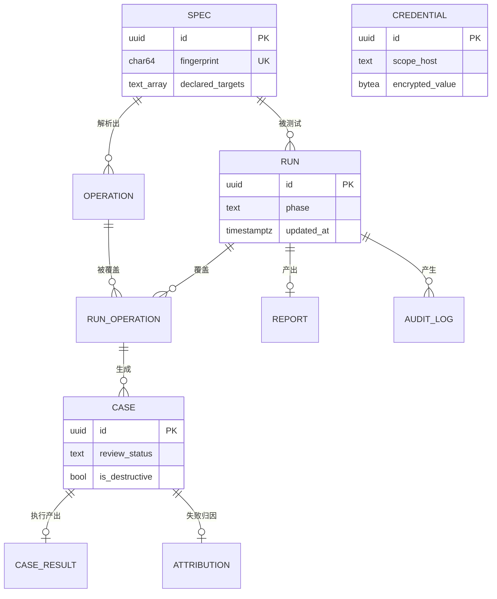

# TestFlow 数据模型

| 项目 | 内容 |
| :--- | :--- |
| 文档版本 | v0.7 |
| 文档状态 | 评审中 |
| 最后更新 | 2026-10-14 |
| 上游文档 | [01-TestFlow_PRD.md](01-TestFlow_PRD.md)、[02-架构设计.md](02-架构设计.md)、[06-Agent编排.md](06-Agent编排.md) |

> **本文档的边界**：描述持久化结构的设计意图——有哪些实体、彼此关系、关键约束与理由。
> **不做**：API 字段（见 `05-API契约.md`）、业务载荷的完整 Pydantic 定义（见 `03-模块详细设计/`）。

> **⚠️ 单一事实来源**：**以 Alembic migration 为准**。本文档与 migration 冲突时，先判断是谁错了——若是文档滞后则改文档，若是无意的 schema 漂移则改 migration 并在此记录。**任何"代码改了但文档没改"的差异都必须显式解决，不允许长期并存。**

**编号约定**：`DM` = 数据模型决策（Data Model decision），与 `02` 的 `D`、`06` 的 `G` 区分。`SR`/`M`/`F`/`Q` 沿用上游编号。

---

## 1. 实体关系总览



`CREDENTIAL` 独立于 Run 生命周期（按 host 复用），故不参与上图的 Run 子树。

---

## 2. 表定义

### 2.1 `specs` —— 上传的 OpenAPI 文档

| 列 | 类型 | 约束 | 说明 |
| :--- | :--- | :--- | :--- |
| `id` | UUID | PK | |
| `fingerprint` | CHAR(64) | UNIQUE NOT NULL | `sha256(规范化内容)`，见 DM2 |
| `filename` | TEXT | | 用户上传时的文件名，仅作展示 |
| `openapi_version` | TEXT | NOT NULL | `3.0.x` / `3.1.x` |
| `raw_content` | TEXT | NOT NULL | 原文。MVP 存 PG，V1.0 迁对象存储 |
| `byte_size` | INTEGER | NOT NULL | |
| `declared_targets` | TEXT[] | NOT NULL | 从 `servers[].url` 提取的目标，值为 `scheme://host:port`。供 Guardrail 白名单（SR-1） |
| `operation_count` | INTEGER | NOT NULL | 冗余计数，避免列表页 join |
| `created_at` | TIMESTAMPTZ | NOT NULL DEFAULT now() | |

**Spec 是不可变的**：内容变了就是另一份 Spec（指纹不同 → 新行）。这个性质让 `declared_targets` 等派生字段可以安全地存在本表——不会出现"同一个 spec_id 的 server 列表变了"的情况。

**为什么存 `scheme://host:port` 而不是只存 host**（M0 更正）：GR3 要求白名单为 `scheme + host + port` 三元组精确匹配，理由是"允许 `http` 等于允许明文传输凭证"。若本列只存 host，白名单就丢失了 scheme 维度，该规则无法执行。故本列原名 `declared_hosts`，在 M0 实现时改名为 `declared_targets`。

### 2.2 `operations` —— Spec 中的一个接口

| 列 | 类型 | 约束 | 说明 |
| :--- | :--- | :--- | :--- |
| `id` | UUID | PK | |
| `spec_id` | UUID | FK → `specs` ON DELETE CASCADE | |
| `method` | TEXT | NOT NULL | GET/POST/PUT/PATCH/DELETE/HEAD/OPTIONS |
| `path` | TEXT | NOT NULL | 原始路径模板，如 `/users/{id}` |
| `operation_id` | TEXT | | OpenAPI 的 `operationId`，可空 |
| `summary` | TEXT | | |
| `parameters_schema` | JSONB | | 裁剪后的参数结构，见下 |
| `request_body_schema` | JSONB | | |
| `responses_schema` | JSONB | | 状态码 → response schema |
| `has_unresolved_ref` | BOOLEAN | NOT NULL DEFAULT false | `$ref` 展开深度超限、保留了字面量。见 `03/SpecParser.md` SP1 / §3.2 |
| `is_destructive` | BOOLEAN | NOT NULL DEFAULT false | 见 DM3 |
| `created_at` | TIMESTAMPTZ | NOT NULL DEFAULT now() | |

约束：`UNIQUE (spec_id, method, path)`

**为什么结构化存储而非存原始 YAML 片段**：Qwen3.5-Plus 的**阶梯计费**按单次请求输入长度分档（`02-架构设计.md` §5.1），超过 128K 单价跳 5 倍。结构化存储让 N2 能**只取当前 Operation 所需的那部分 schema** 拼入提示，而不是把整份 Spec 塞进去。这是把 §5.1 的成本约束落到数据层。

**`has_unresolved_ref` 为什么在 operations 上而非 specs 上**：`$ref` 展开深度是否超限是**逐接口**发生的——同一份 Spec 里可能只有一两个接口引用了超深的递归结构，其余接口完全正常。若标记放在 `specs` 上，就只能整份降级；放在 `operations` 上，则只有受影响的接口所生成的用例被标为低置信度（`03/SpecParser.md` SP1）。

### 2.3 `runs` —— 一次测试执行批次

| 列 | 类型 | 约束 | 说明 |
| :--- | :--- | :--- | :--- |
| `id` | UUID | PK | |
| `spec_id` | UUID | FK → `specs` | |
| `spec_fingerprint` | CHAR(64) | NOT NULL | **快照**，用于 S2 失效判定与历史复现 |
| `phase` | TEXT | NOT NULL | 对应 `06-Agent编排.md` §2.2 的 `RunPhase` |
| `expected_case_count` | INTEGER | NOT NULL DEFAULT 0 | 派生的缓存，见 DM5 |
| `settled_case_count` | INTEGER | NOT NULL DEFAULT 0 | 派生**缓存**，权威判定一律查 `case_results` |
| `approved_case_count` | INTEGER | NOT NULL DEFAULT 0 | |
| `failure_reason` | TEXT | | Run 级硬失败原因（如 Spec 解析失败） |
| `created_at` | TIMESTAMPTZ | NOT NULL DEFAULT now() | |
| `updated_at` | TIMESTAMPTZ | NOT NULL DEFAULT now() | **兜底轮询的扫描依据**（`06` §6.4） |
| `finished_at` | TIMESTAMPTZ | | |

`spec_fingerprint` 与 `spec_id` 并存不是冗余：`spec_id` 是外键（保证引用完整），`fingerprint` 是**Run 发起时刻的事实快照**。若未来允许 Spec 被重新上传覆盖，`spec_id` 指向的会变，而本次 Run 的判定依据不能变。

### 2.4 `run_operations` —— Run 与 Operation 的关联及生成状态

| 列 | 类型 | 约束 | 说明 |
| :--- | :--- | :--- | :--- |
| `run_id` | UUID | FK → `runs` ON DELETE CASCADE | |
| `operation_id` | UUID | FK → `operations` | |
| `gen_status` | TEXT | NOT NULL DEFAULT `'pending'` | `pending` / `succeeded` / `failed` |
| `case_count` | INTEGER | NOT NULL DEFAULT 0 | |
| `error` | TEXT | | 生成失败原因 |

主键：`(run_id, operation_id)`

**这张表存在的唯一理由**：承载 N2 的幂等语义。`02` 的路由表要求"部分 Operation 生成失败不阻塞全局"，而 LLM 输出**不是确定性的**——重跑同一个 Operation 会得到不同用例。因此 N2 的幂等语义不能是"upsert 出相同内容"，只能是"**已完成则跳过**"，而"是否已完成"必须持久化。详见 DM4。

### 2.5 `cases` —— 一条测试用例

| 列 | 类型 | 约束 | 说明 |
| :--- | :--- | :--- | :--- |
| `id` | UUID | PK | |
| `run_id` | UUID | FK → `runs` ON DELETE CASCADE | |
| `operation_id` | UUID | FK → `operations` | |
| `name` | TEXT | NOT NULL | 用例名，如"缺少必填字段 email" |
| `category` | TEXT | NOT NULL | `normal` / `abnormal` / `boundary`（PRD F2） |
| `dimension` | TEXT | NOT NULL | 测试维度标识，如 `boundary:age`、`required_missing:email`。使覆盖率可查询、报告可按维度分布聚合（`03-模块详细设计/TestCaseGen.md` §2.2） |
| `request_method` | TEXT | NOT NULL | |
| `request_path` | TEXT | NOT NULL | 已替换路径参数。**基地址不在这张表上**，见下方说明 |
| `request_query` | JSONB | | |
| `request_headers` | JSONB | | **不含凭证**，凭证在执行期注入（SR-6） |
| `request_body` | JSONB | | |
| `assertions` | JSONB | NOT NULL | 断言数组，形状见 §2.10 |
| `is_destructive` | BOOLEAN | NOT NULL DEFAULT false | 由 `operations.is_destructive` 继承 |
| `requires_auth` | BOOLEAN | NOT NULL DEFAULT true | 执行时是否注入凭证。`auth_missing` 维度生成的用例置 `false`——否则平台会注入凭证使其收到 200 而非预期的 401，测试结果完全错误（`03-模块详细设计/TestExecutor.md` §5.2） |
| `review_status` | TEXT | NOT NULL DEFAULT `'pending'` | `pending` / `approved` / `rejected`（IP-1） |
| `reviewed_at` | TIMESTAMPTZ | | |
| `generated_by` | TEXT | NOT NULL | `llm` / `rule` —— 供 L3 Eval 归因 |
| `llm_model` | TEXT | | 生成时用的模型，供档位对比评测 |
| `confidence` | TEXT | | `high` / `low` —— PRD R2 的"低置信度用例"标注 |
| `created_at` | TIMESTAMPTZ | NOT NULL DEFAULT now() | |

**`request_headers` 不含凭证**是安全设计而非风格选择：Case 会被序列化进 State、可能在日志与界面中出现，凭证一旦混入就难以彻底清除。凭证在 Worker 执行时按 host 从 `credentials` 表解密注入。

**`generated_by` / `llm_model` / `confidence` 三个字段是为 Eval 服务的**（PRD §4.3 L3）。没有它们，"生成质量是否随模型档位下降"这个问题无法用数据回答，降级决策就只能靠感觉。

**⚠️ M1 实现回写——"这条用例打哪个 server"这一列不存在，是一个已知缺口。**

`request_path` 存的是 Spec 里的原始路径（路径参数已替换），但**基地址（scheme + host + port）不在这张表上**。

而 OpenAPI 允许在根级 / 路径级 / 操作级**三层**声明 `servers`，一份文档可以合法地指向多台主机（`03-模块详细设计/SpecParser.md` §5.1 要求三层全部提取）。

**M1 的做法：取 `specs.declared_targets[0]`（第一个）。**

**为什么现在不加列**：加它要给 `cases` 增加一个字段 + 一次迁移，而 M1 的被测对象（fixture）只有一个 server——"多 server 的 Spec"目前**没有任何测试能覆盖**。加了列也只是把不确定性从"取第一个"挪到"这一列该填什么"，并没有真的解决问题。

**这个缺口记在这里，是为了让 M2 引入多目标支持时能找到它**——而不是让下一个人对着"为什么所有请求都打第一台机器"发懵。

判断条件是：**当第一个真实的"多 server 文档"出现时**（用户报告、或 Golden Set 里加入这样一份），再设计这一列。那时会有具体场景决定它的形状（是一个 `target` 字符串？还是指向 `operations` 的哪一层声明？）。

> 另注：`cases` 上没有 `spec_id`——Spec 通过 `operation_id → operations.spec_id` 取到。多绕一层是有意的：让"这条用例属于哪份文档"**只有一个来源**，而不是在两张表上各存一份、迟早不一致。

### 2.6 `case_results` —— 执行结果

| 列 | 类型 | 约束 | 说明 |
| :--- | :--- | :--- | :--- |
| `id` | UUID | PK | |
| `run_id` | UUID | FK → `runs` ON DELETE CASCADE | |
| `case_id` | UUID | FK → `cases` ON DELETE CASCADE | |
| `status` | TEXT | NOT NULL | `passed` / `failed` / `timeout` / `error` |
| `http_status` | INTEGER | | |
| `response_headers` | JSONB | | |
| `response_body` | TEXT | | **截断后**（DM6） |
| `response_body_truncated` | BOOLEAN | NOT NULL DEFAULT false | |
| `response_body_bytes` | BIGINT | | 截断前的原始字节数 |
| `elapsed_ms` | INTEGER | | |
| `error_kind` | TEXT | | 网络层错误类型（连接超时 / DNS / TLS …） |
| `assertion_outcomes` | JSONB | NOT NULL DEFAULT `'[]'` | 逐条断言的求值结果，三态 `passed` / `failed` / `error`。此处 `error` 指**断言无法求值**（如响应体非 JSON），与 `status` 列中指请求层失败的 `error` 是两回事。`status` 的粒度不足以承载这个区分，而它决定了归因能否分辨"服务缺陷"与"响应根本不是 JSON"（`03-模块详细设计/TestExecutor.md` §3.2） |
| `request_digest` | CHAR(64) | | 实际发出请求的摘要，供复现与审计 |
| `attempt` | INTEGER | NOT NULL DEFAULT 1 | 尝试次数 |
| `executed_at` | TIMESTAMPTZ | NOT NULL DEFAULT now() | |

约束：**`UNIQUE (run_id, case_id)`** —— 这是全系统最重要的一个约束，见 DM1。

> **`status` 里没有"系统错误"这一档**：`error` 指的是**请求层面的错误**（如连接被拒），它同样是测试结论的一部分。平台自身的故障（节点崩溃、队列不可用）记在 `runs.failure_reason` 与日志中，**不混入测试结果**。这个区分对应 `06-Agent编排.md` §7 的"系统失败 vs 测试失败"。

### 2.7 `attributions` —— 失败归因

| 列 | 类型 | 约束 | 说明 |
| :--- | :--- | :--- | :--- |
| `id` | UUID | PK | |
| `run_id` | UUID | FK → `runs` ON DELETE CASCADE | |
| `case_id` | UUID | FK → `cases` ON DELETE CASCADE | |
| `category` | TEXT | NOT NULL | 归因类别（枚举在 `03/LogAnalyzer.md` 定义） |
| `method` | TEXT | NOT NULL | `rule` / `llm` —— **用于分别评估两条路径的准确率** |
| `rule_ref` | TEXT | | 命中的规则标识（`method = rule` 时） |
| `llm_model` | TEXT | | |
| `confidence` | TEXT | | |
| `evidence` | JSONB | | 判定依据，供人工复核 |
| `human_verdict` | TEXT | | `agree` / `disagree` / NULL —— 人工纠错（PRD §4.2） |
| `human_category` | TEXT | | 人工判定的**正确类别**；仅当 `human_verdict = 'disagree'` 时填写。它是规则库改进的直接数据来源——只记"同意/不同意"无法回答"该补哪条规则"（`03-模块详细设计/LogAnalyzer.md` §8.2） |
| `created_at` | TIMESTAMPTZ | NOT NULL DEFAULT now() | |

约束：

- `UNIQUE (run_id, case_id)`
- `CHECK category IN (...)` —— 11 类封闭枚举（LA2）
- `CHECK method IN ('rule','llm')`
- `CHECK confidence IS NULL OR confidence IN ('high','medium','low')`
- `CHECK human_category IS NULL OR human_category IN (...)` —— 与 `category` 同一套 11 类
- `CHECK (human_verdict IS NULL AND human_category IS NULL) OR (human_verdict = 'agree' AND human_category IS NULL) OR (human_verdict = 'disagree' AND human_category IS NOT NULL)` —— **LA6 的数据库落点**

> **为什么 LA6 要下沉到数据库**：应用层校验拦不住迁移脚本、手工 SQL、
> 其他写入方，以及将来某个忘了校验的新入口。写在表上，是**所有写入路径的
> 唯一共同出口**（DM7）。后三条由 M3 的迁移 `9f2c1a7b4d10` 加入。

**`method` 字段是 M4 指标的分母来源**。PRD 的 M4（归因 Top-1 人工认可率 ≥ 60%）若不区分规则与 LLM 两条路径，就无法回答"是规则不够还是模型不行"——而这正是 V1.0 决定是否引入 RAG 检索的依据。

### 2.8 `reports`

| 列 | 类型 | 约束 | 说明 |
| :--- | :--- | :--- | :--- |
| `id` | UUID | PK | |
| `run_id` | UUID | FK → `runs` ON DELETE CASCADE, UNIQUE | 一个 Run 一份报告 |
| `content` | JSONB | NOT NULL | 结构化报告数据（聚合指标） |
| `rendered` | TEXT | | 渲染后的 Markdown |
| `created_at` | TIMESTAMPTZ | NOT NULL DEFAULT now() | |

`rendered` 是从 `content` + 模板派生的，理论上可重建。**仍然存储**，理由是历史报告需要**可复现**：模板变更后，三个月前那份报告应保持原样，而不是被新模板重新渲染。

### 2.9 `audit_logs` —— 出站审计（SR-1 ~ SR-5）

| 列 | 类型 | 约束 | 说明 |
| :--- | :--- | :--- | :--- |
| `id` | BIGSERIAL | PK | 追加型日志，无需 UUID |
| `run_id` | UUID | FK → `runs` ON DELETE SET NULL | 可为空（非 Run 关联的出站） |
| `occurred_at` | TIMESTAMPTZ | NOT NULL DEFAULT now() | |
| `direction` | TEXT | NOT NULL | `llm` / `target` |
| `target_host` | TEXT | NOT NULL | |
| `target_url` | TEXT | | 已剥离 query 中的敏感参数 |
| `decision` | TEXT | NOT NULL | `allow` / `deny` |
| `deny_reason` | TEXT | | `whitelist` / `private_ip` / `destructive` / `redirect` / `rate_limit` |
| `request_digest` | CHAR(64) | | |
| `trace_id` | TEXT | | 关联应用日志 |

**只记决策与目标，不记凭证与请求体**（SR-6）。这张表是安全事件的唯一追溯依据，因此**必须记录 `allow` 而不只是 `deny`**——否则无法回答"这个 Run 到底访问了哪些 host"。

**⚠️ M1 实现回写——三处必须写清楚，否则这张表会"有数据但没用"：**

**① `run_id` 必须真的填。** 本节写着"可为空（非 Run 关联的出站）"，那是**例外**，不是默认。而 M1 的实现里，执行器构造审计记录时**忘了把 `run_id` 传下去**——于是每次出站都记了、字段也在，但**全部是 NULL**：按 Run 复盘时一条都查不出来。

> "数据写了但关联丢了"这类 bug 不会报错，只会让审计在最需要它的时候变得没用。验证方式是**按 `run_id` 筛一次**，而不是"看表里有没有行"。

**② `allow` 必须写在「请求发出之前」。** 本节没说时机。实现时按最自然的顺序写成了"发完了再记"——于是**所有超时与失败的请求都留不下任何痕迹**（异常一抛，后面那行代码走不到）。而那恰恰是最该被审计的几条。

判据很简单：**"放行"这个决定在发送之前就已经做出了，它与请求最终成不成功无关。**

**③ `target_url` 的脱敏粒度是"擦掉全部 query 取值、保留全部参数名"。** 本节原文写的是"已剥离 query 中的敏感参数"，暗示可以区分敏感与不敏感。实现时改成**不区分**——按字段名判断必然漏（`?user_id=42` 在医疗接口里就是 PII），而漏一次就是一次真实泄露。

保留参数名是纯粹的信息收益：**"这里有一个叫 `token` 的参数"本身就是一条值得记录下来的设计缺陷。**

另外 `request_digest` 是**哈希**而非原文——这让脱敏多了一道不依赖模式匹配的兜底。

### 2.9.1 `llm_usage` —— 每次模型调用的用量

> 新增于 M4。**不放 `audit_logs`**：审计的 `allow` 写在请求发出之前，那时
> 响应还不存在，token 自然也没有；而且审计是安全日志，不该被回填业务指标。

| 列 | 类型 | 约束 | 说明 |
| :--- | :--- | :--- | :--- |
| `id` | BIGSERIAL | PK | 追加型日志 |
| `run_id` | UUID | FK → `runs` ON DELETE **CASCADE** | 可空（离线基准）；删除 Run 时用量随之消失 |
| `purpose` | TEXT | NOT NULL, CHECK `case_generation` / `attribution` | 成本按用途拆分 |
| `model` | TEXT | NOT NULL | **响应里实际返回的**模型名 |
| `prompt_tokens` | INT | NOT NULL ≥ 0 | |
| `completion_tokens` | INT | NOT NULL ≥ 0 | |
| `cached_tokens` | INT | NOT NULL ≥ 0, `≤ prompt_tokens` | 命中前缀缓存的输入 |
| `cache_write_tokens` | INT | NOT NULL ≥ 0 | 缓存创建（按 125% 计价） |
| `total_tokens` | INT | NOT NULL ≥ 0 | |
| `attempt` | SMALLINT | NOT NULL DEFAULT 1 | 第几次尝试（重试会产生多行） |
| `elapsed_ms` | INT | NOT NULL ≥ 0 | P95 的数据来源 |
| `trace_id` | TEXT | | 关联应用日志 |
| `created_at` | TIMESTAMPTZ | NOT NULL DEFAULT now() | |

索引：`ix_llm_usage_run (run_id)`。

**为什么 `run_id` 是 CASCADE 而审计是 SET NULL**：用量是**这个 Run 的成本**，
Run 删了就没有独立保留价值；审计要回答"曾经发生过什么"，与业务实体是否
还在无关。

**为什么记 `attempt`**：一次接口生成最多重试 2 次。不记尝试序号，就分不清
"成本高"是因为模型慢、还是因为第一版不合格又重来了两次——两者的处置完全不同。

**单价不在表里。** 成本在报告生成时按 `llm/pricing.py` 的单价表计算，
并随报告快照落库；单价日后变化不会改写历史报告（RA4）。

### 2.10 关于 `assertions` 的结构

`assertions` 是 JSONB 数组，形状示意：

```json
[
  {"type": "status_code", "expected": 201},
  {"type": "json_path", "path": "$.data.id", "operator": "exists"},
  {"type": "json_path", "path": "$.error.code", "operator": "eq", "expected": "INVALID_EMAIL"},
  {"type": "response_time", "operator": "lt", "expected_ms": 2000}
]
```

> **权威定义已落在 `03-模块详细设计/TestCaseGen.md` §3**（判别联合 + `derived_from` 标记）。本节只声明该列的承载形状，断言类型枚举与校验规则由模块设计拥有，避免两处定义漂移。

**裁剪粒度已定**：`operations` 的 schema 字段**整块以 JSONB 存储，不按 parameter 拆行**。理由是 schema 是整体（`$ref` 引用、嵌套对象、条件约束），拆成行会破坏结构完整性且拆不干净；裁剪在 N2 组装提示时按需进行（`03/TestCaseGen.md` §6）。

---

## 3. 关键决策

### DM1：幂等键必须是数据库唯一约束

| 项 | 内容 |
| :--- | :--- |
| **决策** | `case_results` 上 `UNIQUE (run_id, case_id)`；写结果一律 `INSERT ... ON CONFLICT DO UPDATE` |
| **理由** | `02` D4 与 `06` §5.3 都要求"恢复/重试不产生重复记录"。若幂等只靠应用层 `SELECT` 后 `INSERT`，并发下必然出现竞态（两个 Worker 同时判断"不存在"）。**只有数据库约束能真正保证幂等**——应用层的判断只是优化 |
| **代价** | 并发写同一 `(run_id, case_id)` 时后者覆盖前者；由于同一 Case 不应被并发执行，这是可接受的 |

### DM2：Spec 指纹的规范化

| 项 | 内容 |
| :--- | :--- |
| **决策** | `fingerprint = sha256(解析为 JSON 后按 key 递归排序再序列化)` |
| **理由** | 直接对原始字节哈希会让**格式差异产生伪变更**：YAML 换行、缩进、key 顺序、注释的改动都会改变指纹，导致 S2 场景误判"Spec 变了"。规范化后再哈希，只对**语义变更**敏感 |
| **影响** | 指纹相同 → 复用 `specs` 行，不重复解析；指纹变化 → 新建 Spec 行，并（V1.0）触发既有用例的失效标记（`02` Q3） |

### DM3：`is_destructive` 存字段而非派生

| 项 | 内容 |
| :--- | :--- |
| **决策** | `operations.is_destructive` 与 `cases.is_destructive` 是**显式存储的字段**，不由 `method` 实时派生 |
| **理由** | 默认值确实由 method 派生（SR-3 规定 DELETE/PUT/PATCH 默认禁用），但**允许显式覆盖**：一个 `POST /users/{id}/close` 在业务上可能是破坏性的；反之 `PUT` 一个幂等的配置项可能无害。若实时派生，就丧失了人工修正的余地 |
| **落地** | 解析时按 method 填默认值，之后可被人工或规则覆盖 |

### DM4：N2 的幂等语义是"跳过"而非"重放"

| 项 | 内容 |
| :--- | :--- |
| **决策** | N2 `generate_cases` 恢复时，对 `run_operations.gen_status = 'succeeded'` 的 Operation **直接跳过**，不重新生成 |
| **理由** | **LLM 输出非确定性**。同一 Operation 重跑会得到不同用例，若在恢复时重新生成，就会出现"用户已经确认过的用例被悄悄换掉"——这比报错严重得多。`06` §5.3 中"N2 幂等键 `(run_id, operation_id)`"的表述不够准确，**本文档为其精确化**：幂等键用于**判定是否已完成**，不用于判定"结果是否相同" |
| **推论** | 只有 `gen_status ∈ {pending, failed}` 的 Operation 会被（重新）生成。这自然实现了 `02` 路由表中的"部分成功不阻塞全局" |

### DM5：状态计数是缓存，不是事实

| 项 | 内容 |
| :--- | :--- |
| **决策** | `runs.expected_case_count` / `settled_case_count` / `approved_case_count` 均为**派生缓存**。任何正确性判断（如 `06` §6.2 的完成判定）**一律以 `SELECT count(*)` 查询 `case_results` 为准** |
| **理由** | 计数字段在恢复、重试、并发写入下都有漂移风险。而"图能否推进"是一个不能出错的判断——宁可每次多一次 `count` 查询，也不要基于可能过期的计数做跳转 |
| **维护** | 计数在节点出口更新（供前端展示）。另设对账任务定期比对缓存与真实值，漂移即告警——这是发现幂等逻辑缺陷的早期信号 |

**⚠️ M2 实现回写——两条都踩过，各补一句：**

**① 这条规则被违反过一次，代价是"整条回调唤醒路径失效"。**
M1 的 `gateway/internal.py` 用 `runs.expected_case_count` 做 `06` §6.2 的完成判定
——正是本行明令禁止的事。而那个缓存**没有任何节点维护它**（"维护"那一行在 M1
只是意图，不是事实），恒为 0。于是：

```
expected == 0  →  判定永远返回 pending  →  每次回调都空转
               →  Run 只能靠兜底轮询（每分钟一次）往前挪
```

**"缓存没人维护"与"有人拿缓存做判断"是两件各自看起来无害的事，
合起来是一次静默的功能失效。** 这个组合之所以值得单独记一笔：单看任何一半
都不像缺陷——没维护的展示字段多的是，读一个自己写的字段也无可厚非。

M2 的修法：判定改用 `SELECT count(*)`（两个数都查 PG），缓存则由 N4/N5
在节点出口**真的写**（于是"维护"那一行从意图变成了事实）。

**② `expected_case_count` 的口径必须是"应当有结果的用例数"，不是"生成了多少条"。**
这一条文档原先没说，而它决定了完成判定成不成立：

```
应当有结果的 = review_status = 'approved' AND is_destructive = false
```

其余用例（被人工拒绝的、破坏性的）**永远不会**有结果——N4 从不投递它们。
用生成条数当分母，`settled < expected` 就**永远成立**：每次运行都会多记
一条 `partial_results` 失败，并去补记缺失的那些为 timeout（后者会把
"用户主动跳过"写成"目标接口超时"，见 DM5 下游的 `case_results` 语义）。

**这个口径必须与 N4 的投递条件逐条对齐**，两处不一致时一边多算一边少算。
它是"应当有结果"这件事的**定义**，所以写在数据模型里而不是散在节点实现中。

### DM6：响应体截断上限 256 KB（解答 `02` Q2）

| 项 | 内容 |
| :--- | :--- |
| **决策** | `response_body` 截断至 **256 KB**；超限时置 `truncated = true` 并记录 `response_body_bytes` 原始长度 |
| **理由** | 归因所需的信息（HTTP 状态、错误码、错误消息）几乎总在响应体的**前几 KB**。256 KB 对绝大多数接口是"全文"，同时对极端大响应（如导出接口返回数十 MB）形成硬保护——避免单条结果撑爆 PG 行、拖慢报告聚合、并在 V1.0 迁对象存储前留下缓冲 |
| **对归因的影响** | 被截断的响应体在 `LogAnalyzer` 的输入中标记 `truncated`，使归因结果可解释："因响应体被截断，归因置信度降低"。**不静默截断**——静默截断会让归因在一无所知的情况下得出错误结论 |

### DM7：枚举用 TEXT + CHECK，不用 PG ENUM

| 项 | 内容 |
| :--- | :--- |
| **决策** | 所有状态/类别字段用 `TEXT` 加 `CHECK (col IN (...))` 约束 |
| **理由** | PG 原生 `ENUM` 增加取值需要 `ALTER TYPE ... ADD VALUE`，该语句在 PG 12 之前无法在事务中回滚，且不能删除取值。我们的枚举（归因类别、断言类型）在项目早期必然演进。TEXT + CHECK 的改动只是一条 `ALTER TABLE ... DROP CONSTRAINT / ADD CONSTRAINT` |
| **代价** | 存储略大、无编译期类型安全。前者可忽略，后者由应用层的 Python `Enum` 与 Pydantic 承担 |

### DM8：ID 类型与生成策略

| 项 | 内容 |
| :--- | :--- |
| **决策** | 实体表用 **UUIDv7**（时间有序）；仅 `audit_logs` 用 `BIGSERIAL` |
| **理由** | UUID 避免 ID 枚举泄露（审计日志尤其敏感）；v7 的时间有序性避免了 v4 随机 UUID 造成的 B-tree 索引页分裂——写入吞吐显著更好。`audit_logs` 是纯追加型日志，`BIGSERIAL` 更省空间且无需 ID 语义 |
| **落地** | 若所用 PG 版本无 `uuidv7()`，在应用侧生成后写入。**不要退回 UUIDv4 而不记录这个取舍** |

---

## 4. 索引与关键查询

| 索引 | 服务的查询 |
| :--- | :--- |
| `runs (phase, updated_at)` | **兜底轮询**：扫描 `phase = 'awaiting_results'` 且超期的 Run（`06` §6.4） |
| `case_results (run_id)` | 完成判定 `count(*)`、报告聚合 |
| `cases (run_id, review_status)` | IP-1 前端拉取待确认用例 |
| `cases (run_id, operation_id)` | N4 组装执行集合 |
| `attributions (run_id)` | 报告生成的错误分布统计 |
| `audit_logs (run_id)`、`audit_logs (occurred_at)` | 安全追溯 |
| `operations (spec_id)` | Spec 详情页与 N2 遍历 |

---

## 5. 数据保留与清理

PRD §5 规定 Run 与结果保留 **90 天**。策略：

- **以 Run 为删除单位**，级联删除 `cases` / `case_results` / `attributions` / `reports` / `run_operations`
- `specs` / `operations` **不随 Run 删除**：Spec 可被多个 Run 复用。删除孤儿 Spec（无任何 Run 引用且超过 90 天）是独立任务
- `audit_logs` 同样保留 90 天，但**采用 `ON DELETE SET NULL` 而非级联**——审计记录在 Run 删除后仍应保留其"发生过"的事实，只是失去 Run 关联
- `credentials` 不参与保留策略，由用户显式管理

清理任务本身必须**幂等且可重入**（中断后重跑不应报错），并记录每次删除的数量以便审计。

**落地（M5）与一处刻意偏差**

- 清理任务：`graph/tasks_beat.py::cleanup_expired_data`，每日 03:37 由 beat 投递。
  先删 Run（按 `created_at` 分批 500），再删孤儿 Spec（`NOT EXISTS` 反向探测）。
- 两个清理查询各有索引：`runs(created_at)`、`runs(spec_id)`、`specs(created_at)`
  （迁移 `b2c3d4e5f6a7`）。PostgreSQL **不会**为外键自动建索引，没有 `runs(spec_id)`
  时每个 Spec 的孤儿判定都是一次全表扫。
- **`audit_logs` 不参与自动清理。** 本节原文说审计日志同样保留 90 天；M5 决定
  暂不实现那条删除。原因：审计是"发生过什么"的唯一凭证，批量删除它的能力
  应当有独立的人工授权入口，而不是藏在每日定时任务里。Run 删除会把
  `audit_logs.run_id` 置 NULL（外键 `SET NULL`），记录本身保留。
  这是一处**有意的文档—实现偏差**，在需要审计留存合规之前保持现状。

---

## 6. 与 GraphState 的对应关系

`06-Agent编排.md` §2.2 的 `GraphState` 与本模型存在刻意的字段重叠，关系如下：

| GraphState 字段 | 持久化位置 | 权威方 |
| :--- | :--- | :--- |
| `phase` | `runs.phase` | **PG**（State 是快照） |
| `spec_fingerprint` | `runs.spec_fingerprint` | PG |
| `target_operation_ids` | `run_operations` | PG |
| `case_ids` / `approved_case_ids` | `cases` | PG |
| `expected_case_count` / `settled_case_count` | `runs.*` | **PG**（State 中的值是缓存，见 DM5） |
| `attribution_ids` | `attributions` | PG |
| `report_id` | `reports` | PG |
| `node_failures` / `retry_counts` | **无对应表** | **State 独有**，随 Checkpoint 存于 Redis |

**唯一不落 PG 的是 `node_failures` 与 `retry_counts`**——它们描述的是"这一次推进过程"的临时状况，Run 结束后诊断价值主要由日志承担。若后续需要持久化失败审计，再单独建表，不往 `runs` 上加 JSONB 字段。

---

## 7. 开放问题

| 编号 | 问题 | 影响 | 待决 |
| :--- | :--- | :--- | :--- |
| Q3 | 孤儿 Spec 的清理是否需要（若 MVP 单用户、Spec 复用率低，可能长期不需要） | 影响 §5 清理任务的复杂度 | V1.0 评估 |

**已关闭问题**：

| 问题 | 关闭结论 |
| :--- | :--- |
| ~~schema 字段的裁剪粒度~~（v0.1 的 Q1） | **整块 JSONB 存储，不按 parameter 拆行**——schema 是整体（`$ref`、嵌套、条件约束），拆行会破坏结构完整性且拆不干净；裁剪在 N2 组装提示时按需进行。见 §2.10 与 `03/TestCaseGen.md` §6 |
| ~~`assertions` 列的结构~~（v0.1 §2.10 待定） | 已定于 `03-模块详细设计/TestCaseGen.md` §3：判别联合模型（`status_code` / `json_path` / `header` / `schema_valid` / `body_contains` / `response_time`），每条断言带 `derived_from: spec \| inferred` |
| ~~归因类别枚举~~（v0.1 的 Q2） | 已定于 `03-模块详细设计/LogAnalyzer.md` §3：**11 类**封闭枚举（`request_invalid` / `auth_error` / `resource_not_found` / `conflict` / `rate_limited` / `server_error` / `response_schema_mismatch` / `assertion_mismatch` / `network_error` / `blocked_by_policy` / `unknown`），每类附带责任归属与排查方向。**该枚举是封闭的**——LLM 兜底只能在其中选择，不可自由生成类别名 |

---

## 8. 与上游文档的追溯

| 上游条目 | 本文档落点 |
| :--- | :--- |
| PRD F2 生成结构化用例 | §2.5 `cases` |
| PRD F4 记录请求/响应/耗时/状态码 | §2.6 `case_results` |
| PRD F5 归因与人工纠错 | §2.7 `attributions` 的 `method` / `human_verdict` |
| PRD F7 出站审计 | §2.9 `audit_logs` |
| PRD §4.3 L3 Eval | §2.5 的 `generated_by` / `llm_model` / `confidence` |
| PRD §5 保留 90 天 | §5 |
| PRD §5 幂等性（Run ID + Case ID） | §2.6 `UNIQUE (run_id, case_id)`、DM1 |
| PRD SR-3 破坏性默认禁用 | §2.2 / §2.5 `is_destructive`、DM3 |
| PRD SR-6 凭证加密 | §2.9（不记凭证）、§2.5（Case 不含凭证） |
| 02 D4 结果先落库 | DM1 |
| 02 Q2 日志上限 | **DM6（已解答：256 KB）** |
| 02 Q3 Spec 变更标记失效 | DM2（提供机制；行为属 V1.0） |
| 02 §5.1 阶梯计费 | §2.2 结构化存储的理由 |
| 06 §2.2 GraphState | §6 对应关系表 |
| 06 §5.3 幂等要求 | **DM4（已精确化 N2 的语义）** |

---

## 9. 变更记录

| 版本 | 日期 | 变更内容 |
| :--- | :--- | :--- |
| v0.1 | 2026-10-13 | 初稿：9 张表 + ER 图、DM1~DM8、索引与保留策略、GraphState 对应关系；解答 `02` Q2（日志上限 256 KB）；精确化 `06` §5.3 中 N2 的幂等语义（DM4） |
| v0.2 | 2026-10-13 | `cases` 新增 **`dimension`** 列（支撑覆盖率查询与按维度聚合的报告）；`assertions` 结构定于 `03/TestCaseGen.md` §3，关闭本条开放问题；关闭裁剪粒度问题（整块 JSONB，不拆行） |
| v0.3 | 2026-10-13 | `attributions` 新增 **`human_category`** 列（人工判定的正确类别，是规则库改进的数据来源，见 `03/LogAnalyzer.md` §8.2）；关闭归因类别枚举问题（定于 `03/LogAnalyzer.md` §3，10 类封闭枚举） |
| v0.4 | 2026-10-13 | `case_results` 新增 **`assertion_outcomes`** 列（断言级三态结果，`status` 粒度不足以区分"断言不符"与"断言无法求值"）；`cases` 新增 **`requires_auth`** 列（`auth_missing` 维度用例需禁用凭证注入）。两项均来自 `03/TestExecutor.md` |
| v0.5 | 2026-10-13 | 归因类别枚举由 10 类更新为 **11 类**（新增 `blocked_by_policy`，来自 `03/Guardrail.md` §8.2）。**无 schema 变更**——该枚举是 `attributions.category` 的 CHECK 约束取值，权威定义在 `03/LogAnalyzer.md` §3 |
| v0.6 | 2026-10-14 | 随 M0 实现回写两处：① §2.1 `declared_hosts` → **`declared_targets`**，值域由 `host:port` 改为 `scheme://host:port`（GR3 要求白名单含 scheme）；② §2.2 `operations` 新增 **`has_unresolved_ref`** 列（`$ref` 展开深度超限的逐接口标记，`03/SpecParser.md` SP1 要求，原文档遗漏）。**本版无既有字段被删除**，两处均为命名对齐与补漏 |
| v0.7 | 2026-10-14 | **随 M1 实现回写（无 schema 变更，三处补记）**：① §2.5 补记「这条用例打哪个 server」这一列**不存在**——M1 取 `declared_targets[0]`，缺口留给 M2；② §2.9 补 `audit_logs` 的三条使用约束：`run_id` **必须真的填**（否则关联断了）、`allow` 必须写在**发送之前**（否则超时与失败不留痕）、脱敏粒度定为「擦全部取值、留全部参数名」 |
| v0.8 | 2026-10-15 | **随 M2 实现回写（无 schema 变更，DM5 补两条）**：① **DM5 的规则被违反过一次**——M1 的 `gateway/internal.py` 用 `runs.expected_case_count` 做完成判定（正是 DM5 明令禁止的），而那个缓存没有任何节点维护、恒为 0，于是判定永远返回 `pending`、**回调唤醒整条路径失效**（实测一次端到端 62.9s → 修后 3.2s）。记下"缓存没人维护"与"有人拿缓存做判断"这**两个各自无害的决定合起来形成静默失效**；② 补 `expected_case_count` 的**口径**：它是"**应当有结果**的用例数"（`review_status = 'approved' AND is_destructive = false`），**不是**"生成了多少条"——用生成条数当分母会让 `settled < expected` 永远成立。该口径必须与 N4 的投递条件逐条对齐，因此定在数据模型里而不是散在节点实现中 |
